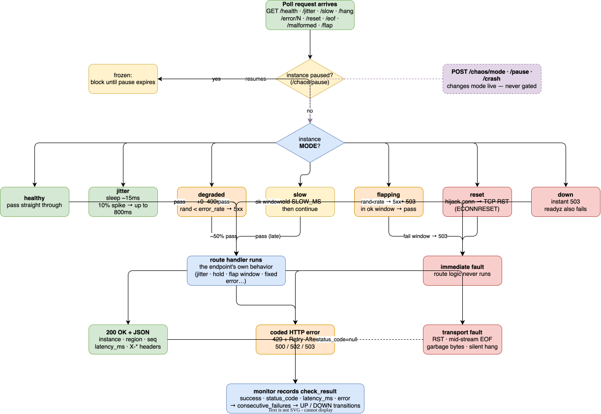
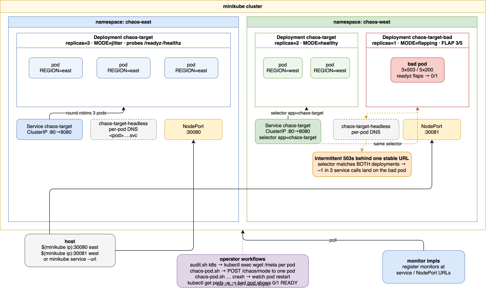

# chaos-target — controllable upstream fixtures for the health monitors

`chaos-target` is a single-binary Go app that plays the *other side* of the
polyglot health monitor: instead of pointing monitors at one static `/health`
route, you get a fleet of deterministic, remotely-controllable "servers" that
simulate real upstream behavior — healthy, jittered, erroring, slow, hanging,
connection-resetting, flapping — exactly what `RedMe.md` calls for.

No external dependencies (stdlib `net/http` + `http.Hijacker` for real TCP
resets). One image runs every fixture; behavior is chosen by `MODE` env or
live via the `/chaos/*` API.

## Diagrams — the 30-second tour

Click any diagram to zoom (glightbox). These cover most of this page —
the `.drawio` sources live in `../../monitored-app` if you want to edit them.

### Request flow — how one poll request is handled

One request's path: pause gate → **MODE** gate → route handler →
200 / coded error / transport fault → recorded as a `check_result`.



### Architecture — the fixture suite end to end

Your 4 monitor impls → compose fixture fleet (`.local` aliases + host ports)
and the minikube fleets → chaos control scripts.


### Minikube — east & west topology

`chaos-east` (3 jittered pods) vs `chaos-west` (2 healthy + 1 born-bad pod
sharing the Service → intermittent 503s).



## Layout

```text
healthDemo/
├── chaos-target/        # the Go app + Dockerfile + netem entrypoint
├── deploy/
│   └── docker-compose.yml   # full local fixture suite, .local hostnames
├── k8s/
│   └── minikube.yaml        # east + west fleets, incl. a born-bad pod
├── diagrams/            # draw.io: request flow, architecture, k8s topology
├── scripts/
│   ├── smoke.sh             # exercise every endpoint on one instance
│   ├── chaos.sh             # flip a compose/local instance's mode
│   ├── chaos-pod.sh         # flip one pod's mode inside minikube
│   ├── audit.sh             # per-instance mode table (compose|k8s)
│   ├── seed-monitors.sh     # register all fixtures with a monitor API
│   └── reset-all.sh         # clean-state reset between test runs
└── RedMe.md               # the requirements this implements
```

## Poll endpoints (what monitors check)

The request-flow diagram above shows how these are gated by MODE first.

| Route | Behavior |
| --- | --- |
| `GET /health`, `/ok` | fast 200 + JSON payload |
| `GET /jitter` | ~15 ms baseline, ~10% of requests spike up to 800 ms |
| `GET /slow?ms=N` | holds N ms then 200 (default `SLOW_MS`, cap 60 s) |
| `GET /hang` | accepts the socket, never sends a byte — pure timeout test |
| `GET /error/{429,500,502,503}` | fixed errors; 429 carries `Retry-After` |
| `GET /reset` | TCP RST — client sees "connection reset by peer" |
| `GET /eof` | valid headers + truncated body, then RST — "unexpected EOF" |
| `GET /malformed` | non-HTTP garbage bytes — parse-failure test |
| `GET /flap` | 3× 503 then 3× 200, repeating (tunable) — transition tests |

Every response carries `X-Instance-Id`, `X-Region`, `X-Mode`, `X-Request-Seq`
headers and a JSON body, so monitors (and you) can see *which* replica answered.

## Control endpoints (chaos API — always reachable)

| Route                          | Effect                                           |
| :----------------------------- | :----------------------------------------------- |
| `GET /meta`                    | instance id, region, mode, uptime, request count |
| `GET /chaos/state`             | current behavior config                          |
| `POST /chaos/mode`             | set mode + tunables (query params or JSON)       |
| `POST /chaos/pause?seconds=N`  | freeze: requests stall, readyz fails             |
| `POST /chaos/crash`            | `exit(1)` after responding — restart tests       |
| `POST /chaos/reset`            | back to healthy, zero counters                   |
| `GET /healthz` / `GET /readyz` | liveness / readiness (readyz reflects mode)      |

Modes: `healthy` `jitter` `degraded` `slow` `flapping` `reset` `down` —
a mode applies to *every* poll endpoint, so one POST turns a whole "server" bad.

## Run it — bare metal first

```bash
cd healthDemo/chaos-target
go run .            # or: MODE=flapping PORT=8090 go run .
../scripts/smoke.sh http://localhost:8080
```

## Run it — Docker Compose fixture suite

```bash
cd healthDemo/deploy
docker compose up -d --build
../scripts/smoke.sh http://localhost:9001     # the ok.local instance
../scripts/audit.sh compose                    # table of all instances
```

| Instance | Aliases (in `fixtures` net) | Host port | Behavior |
| --- | --- | --- | --- |
| ok | `ok.local`, `healthy.local` | 9001 | fast 200 |
| jitter | `jitter.local` | 9002 | 15 ms + spikes |
| slow | `slow.local`, `hang.local` | 9003 | 5 s responses |
| flaky | `flaky.local`, `flap.local` | 9004 | 3 fail / 3 ok |
| errors | `errors.local`, `bad.local` | 9005 | ~50% random 5xx |
| reset | `reset.local`, `eof.local` | 9006 | TCP RST |
| netem | `netem.local` | 9007 | real `tc netem` 150 ms/5% loss |
| chaos-east | `east.local` | 9010 | healthy until you break it |
| chaos-west | `west.local` | 9011 | healthy until you break it |

Monitors on the host use `http://localhost:9xxx`; monitors inside the
`fixtures` network use `http://ok.local:8080`-style aliases.

```bash
../scripts/chaos.sh http://localhost:9010 degraded error_rate=0.8   # break east
../scripts/chaos.sh http://localhost:9010 reset                     # heal it
../scripts/reset-all.sh                                             # heal all
```

## Run it — minikube, east & west

See the [east/west topology diagram](#minikube--east--west-topology) above for the full layout.

```bash
minikube start
eval $(minikube docker-env)                       # build inside minikube
docker build -t chaos-target:latest ../chaos-target
kubectl apply -f ../k8s/minikube.yaml
kubectl get pods -n chaos-west -w                  # one pod flaps on purpose
../scripts/audit.sh k8s                            # find the bad server
```

- `chaos-east`: 3 jittered replicas  ·  `chaos-west`: 2 healthy + **1 born-bad
  flapping pod that shares the Service** — polling the service URL
  intermittently 503s, like a real sick backend behind a load balancer.
- Per-pod URLs: `<pod>.chaos-target-headless.<ns>.svc` (headless Service).
- Host access: `$(minikube ip):30080` (east) / `:30081` (west), or
  `minikube service chaos-target-nodeport -n chaos-east --url`.
- Break/heal one pod in place:
  `../scripts/chaos-pod.sh chaos-west <pod-name> down` … `reset`.
- Crash-loop test: `../scripts/chaos-pod.sh chaos-east <pod> crash` then watch
  `kubectl get pods` restart it (liveness stays up; only the process dies).

## Point a monitor at it

```bash
# monitor running on the host, fixtures in compose:
../scripts/seed-monitors.sh http://localhost:8080     # its /api/v1
curl localhost:8080/api/v1/monitors                    # watch UP/DOWN states
```

Each seed respects the shared spec (`interval_seconds >= 5`, `timeout_ms >=
100`). `slow-vs-timeout` (5 s response vs 2 s timeout) is the timeout-enforcement
check; `flappy` exercises DOWN→UP transition history; `connreset` exercises
transport-error recording.

## Config reference (env)

`PORT` (8080) · `REGION` (local) · `INSTANCE_ID` (hostname) · `MODE` (healthy) ·
`SLOW_MS` (5000) · `LATENCY_MS` (0) · `ERROR_RATE` (0.5) · `FLAP_FAIL`/`FLAP_OK`
(3/3) · `JITTER_MS` (15) · `SPIKE_MS` (800) · `LOG_LEVEL` (info) ·
`NETEM_DELAY` / `NETEM_JITTER` / `NETEM_LOSS` / `NETEM_CORRUPT` / `NETEM_IFACE`
(packet-level faults via `tc netem`; needs root + `NET_ADMIN`)
