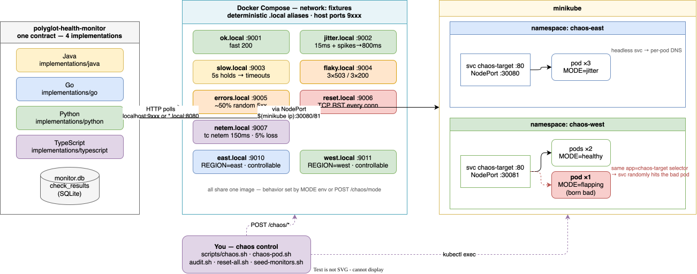

# chaos-target — controllable upstream fixtures for the health monitors

`chaos-target` is a single-binary Go app that plays the *other side* of the
polyglot health monitor: instead of pointing monitors at one static `/health`
route, you get a fleet of deterministic, remotely-controllable "servers" that
simulate real upstream behavior — healthy, jittered, erroring, slow, hanging,
connection-resetting, flapping — exactly what `monitored-app/ReadMe.md` calls for.

No external dependencies (stdlib `net/http` + `http.Hijacker` for real TCP
resets). One image runs every fixture; behavior is chosen by `MODE` env or
live via the `/chaos/*` API — or hands-free via canned **scenarios** and the
dashboard's Chaos page.

## Diagrams — the 30-second tour

Click any diagram to zoom (glightbox). These cover most of this page —
the `.drawio` sources live alongside the SVGs in `diagrams/` if you want to edit them.

### Request flow — how one poll request is handled

One request's path: pause gate → **MODE** gate → route handler →
200 / coded error / transport fault → recorded as a `check_result`.


### Architecture — the fixture suite end to end

Your 4 monitor impls → the minikube fleets (east + west namespaces, NodePort
host access) → chaos control scripts.



### Minikube: east and west topology

`chaos-east` (3 jittered pods) vs `chaos-west` (2 healthy + 1 born-bad pod
sharing the Service → intermittent 503s).


## Layout

```text
monitored-app/
├── 0-simple-demo/       # one-route FastAPI app (/health) — the "good" fixture
├── chaos-target/        # the Go app + Dockerfile
├── k8s/
│   └── minikube.yaml        # east + west fleets, incl. a born-bad pod
├── scripts/
│   ├── smoke.sh             # exercise every endpoint on one instance
│   ├── chaos.sh             # flip an instance's mode via its URL or run a scenario
│   ├── chaos-pod.sh         # flip one pod's mode inside minikube
│   ├── audit.sh             # per-pod mode table for the minikube fleets
│   ├── seed-monitors.sh     # register all fixtures with a monitor API
│   └── reset-all.sh         # clean-state reset between test runs
└── ReadMe.md
```

## The baseline fixture — `0-simple-demo`

Before the fleet, there's the boring one: a FastAPI app with a single
`GET /health` route that returns `200 OK` with a plain-text `OK` body — the
"always good" upstream for a first end-to-end monitor test.

```bash
cd monitored-app/0-simple-demo
uv run fastapi dev --port 8090
curl localhost:8090/health          # → OK
```

## Poll endpoints (what monitors check)

The request-flow diagram above shows how these are gated by MODE first.

| Route | Behavior |
| --- | --- |
| `GET /health`, `/ok` | fast 200 + JSON payload |
| `GET /jitter` | ~15 ms baseline, ~10% of requests spike up to 800 ms |
| `GET /slow?ms=N` | holds N ms then 200 (default `SLOW_MS`, cap 60 s) |
| `GET /hang` | accepts the socket, never sends a byte — pure timeout test |
| `GET /error/{429,500,502,503}` | fixed errors; 429 carries `Retry-After` |
| `GET /reset` | TCP RST — client sees "connection reset by peer" |
| `GET /eof` | valid headers + truncated body, then RST — "unexpected EOF" |
| `GET /malformed` | non-HTTP garbage bytes — parse-failure test |
| `GET /flap` | 3× 503 then 3× 200, repeating (tunable) — transition tests |

Every response carries `X-Instance-Id`, `X-Region`, `X-Mode`, `X-Request-Seq`
headers and a JSON body, so monitors (and you) can see *which* replica answered.

## Control endpoints (chaos API — always reachable)

| Route | Effect |
| ----- | ------ |
| `GET /meta` | identity, mode, uptime, request count, poll stats, scenario |
| `GET /chaos/state` | current behavior config |
| `POST /chaos/mode` | set mode + tunables (query params or JSON) |
| `POST /chaos/pause?seconds=N` | freeze: requests stall, readyz fails |
| `POST /chaos/crash` | `exit(1)` after responding — restart tests |
| `POST /chaos/reset` | back to healthy, cancel scenario, zero counters |
| `GET /chaos/scenario` | running scenario + catalog of canned sequences |
| `POST /chaos/scenario?name=X` | run a timed mode sequence — hands-free chaos |
| `DELETE /chaos/scenario` | cancel the running scenario, keep current mode |
| `GET /chaos/history` | recent chaos events: mode flips, pauses, scenario steps |
| `GET /metrics` | Prometheus exposition: uptime, paused, polls by route+code |
| `GET /healthz` / `GET /readyz` | liveness / readiness (readyz reflects mode) |

Modes: `healthy` `jitter` `degraded` `slow` `flapping` `reset` `down` —
a mode applies to *every* poll endpoint, so one POST turns a whole "server" bad.

## Scenarios — chaos without a human at the keyboard

`POST /chaos/scenario?name=X` runs a canned sequence of mode changes on a
timer, so a demo can show an outage *evolving* instead of being toggled. One
scenario runs at a time; starting another (or `POST /chaos/reset`) cancels it.

| Name | Sequence |
| --- | --- |
| `outage` | `down` 30 s → `healthy` |
| `brownout` | `degraded` 30 s → `healthy` |
| `flap-storm` | `flapping` 45 s → `healthy` |
| `slow-leak` | `slow` 30 s → `healthy` |
| `chaos-tour` | `jitter` 15 s → `degraded` 15 s → `down` 10 s → `healthy` |

```bash
curl -X POST 'localhost:9020/chaos/scenario?name=chaos-tour'
curl localhost:9020/chaos/scenario          # progress: running, step n/m
curl -X DELETE localhost:9020/chaos/scenario # bail out early
```

## Observability — stats, history, metrics

- **`GET /meta`** now reports `stats.by_endpoint` / `stats.by_code` — what the
  instance actually served, including `"fault"` for hijacked connections that
  never produced an HTTP response (`/reset`, `/eof`, `/malformed`, `/hang`).
- **`GET /chaos/history`** returns a bounded log (last 100) of control actions:
  `mode` transitions, `pause`/`crash`/`reset`, and scenario start/step/cancel —
  correlate "monitor went DOWN at T" with the chaos action that caused it.
- **`GET /metrics`** emits Prometheus text format
  (`chaos_target_poll_requests_total{endpoint,code}`,
  `chaos_target_uptime_seconds`, `chaos_target_paused`,
  `chaos_target_mode_info{mode,instance,region}`).

## Run it — from the UI dashboard

`uv run ui-dashboard/dashboard.py` → <http://localhost:9000> → **Chaos** tab:
start/stop the target as a managed process, flip modes with buttons, fire a
scenario, watch the event history — and **Watch** registers the target's
`/health` as a monitor on whichever implementation is running, so the demo
loop is entirely point-and-click.

The full fixture fleet runs on **minikube** (below) — the Kubernetes skills
transfer directly to any real cluster. Bare metal remains as a lighter-weight
option for quick single-instance checks.

## Run it — bare metal

```bash
cd monitored-app/chaos-target
go run .            # or: MODE=flapping PORT=8090 go run .
../scripts/smoke.sh http://localhost:8080
```

## Run it — minikube, east & west

See the [east/west topology diagram](#minikube-east-and-west-topology) above for the full layout.

```bash
cd monitored-app
minikube start
eval $(minikube docker-env)                        # build inside minikube
docker build -t chaos-target:latest chaos-target
kubectl apply -f k8s/minikube.yaml
kubectl get pods -n chaos-west -w                  # one pod flaps on purpose
scripts/audit.sh                                   # find the bad server
```

- `chaos-east`: 3 jittered replicas  ·  `chaos-west`: 2 healthy + **1 born-bad
  flapping pod that shares the Service** — polling the service URL
  intermittently 503s, like a real sick backend behind a load balancer.
- Per-pod URLs: `<pod>.chaos-target-headless.<ns>.svc` (headless Service).
- Host access: `$(minikube ip):30080` (east) / `:30081` (west), or
  `minikube service chaos-target-nodeport -n chaos-east --url`.
- Break/heal one pod in place:
  `scripts/chaos-pod.sh chaos-west <pod-name> down` … `reset`.
- Crash-loop test: `scripts/chaos-pod.sh chaos-east <pod> crash` then watch
  `kubectl get pods` restart it (liveness stays up; only the process dies).
- `scripts/reset-all.sh` heals every pod in both namespaces between test runs.

## Point a monitor at it

```bash
# monitor running on the host, fixtures behind minikube NodePorts:
scripts/seed-monitors.sh http://localhost:8080     # its /api/v1
curl localhost:8080/api/v1/monitors                # watch UP/DOWN states
```

Each seed respects the shared spec (`interval_seconds >= 5`, `timeout_ms >=
100`). `east-slow-vs-timeout` (5 s response vs 2 s timeout) is the
timeout-enforcement check; `east-flap` exercises DOWN→UP transition history;
`west-sick-pod` exercises the intermittent 503s from the born-bad pod behind
the Service.

## Config reference (env)

`PORT` (8080) · `REGION` (local) · `INSTANCE_ID` (hostname) · `MODE` (healthy) ·
`SLOW_MS` (5000) · `LATENCY_MS` (0) · `ERROR_RATE` (0.5) · `FLAP_FAIL`/`FLAP_OK`
(3/3) · `JITTER_MS` (15) · `SPIKE_MS` (800) · `LOG_LEVEL` (info)
